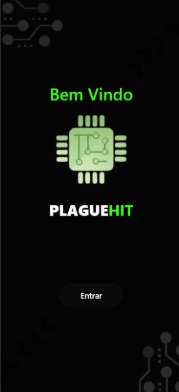
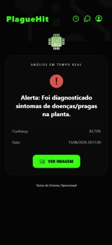
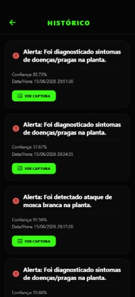
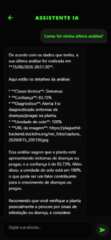

# Português - Brasil

# 🌾 PlagueHit

O **PlagueHit** é um aplicativo móvel que une **inteligência artificial**, **visão computacional** e **sensores IoT** para o monitoramento agrícola. Um modelo de deep learning treinado por nós identifica pragas e sintomas em folhas de **feijão**, enquanto sensores medem as condições do solo em tempo real. Um **chatbot** dentro do app orienta o produtor.

## 📱 Telas do App

<p align="center">
  
  
  
  
</p>

<p align="center">
  <sub>Boas-vindas · Dashboard em tempo real · Histórico · Assistente de IA</sub>
</p>

---

## 🧠 Inteligência Artificial

### Modelo de detecção de pragas (visão computacional)

Treinamos uma rede neural convolucional (CNN) com **TensorFlow/Keras** para classificar fotos de folhas de feijão em três classes:

| Classe | Significado |
|---|---|
| `mosca_branca` | Folha com presença de mosca-branca |
| `saudavel` | Folha saudável |
| `sintomas` | Folha com sintomas visíveis |

- **InputInput:** images resized to 150x150 px and normalized (0 to 1).
- **Output:** predicted class + confidence score (%).
- **Architecture / technique:** Transfer learning using MobileNetV2 as the base feature extractor, combined with custom classification layers (Global Average Pooling, a 256-unit Dense layer with Dropout, and a final 3-unit Dense layer).
- **Dataset:** 150 imagens no total, balanceadas com 50 itens para cada classe (`mosca_branca`, `saudavel`, `sintomas`).
- **Resultados:** **87,50% de acurácia** no conjunto de avaliação.
- **Treinamento:** Google Colab, com duas versões do modelo (`modelo_pragas_feijao.keras` e `modelo_pragas_feijao_v2.keras`).

### Explicabilidade com Grad-CAM

Para não entregar um diagnóstico "caixa-preta", o projeto usa **Grad-CAM**: além da classe prevista, o sistema gera um **mapa de calor** sobre a foto original, mostrando quais regiões da folha mais influenciaram a decisão do modelo. Isso ajuda o produtor e o agrônomo a **validar visualmente** o resultado.

O script de diagnóstico (`ia/diagnostico_gradcam.py`) carrega o modelo, lê a resolução esperada automaticamente, localiza a última camada convolucional e exibe a imagem original ao lado do diagnóstico com o mapa de calor.

### Integração com o app

**[PREENCHER: explique como o modelo chega ao app. Ex.: API em Python que recebe a foto e devolve a classe, modelo convertido para TFLite, imagem vinda da ESP32-CAM etc.]**

### 🤖 Chatbot

O app conta com um chatbot para apoiar o produtor.

- **Modelo/API utilizado:** **[PREENCHER: ex.: Gemini, OpenAI etc.]**
- **O que ele faz:** o Assistente IA responde perguntas do produtor usando os dados reais das análises (classe, confiança, data e umidade do solo). Por exemplo, ao perguntar "Como foi minha última análise?", ele resume o diagnóstico, interpreta o resultado e recomenda os próximos passos.

---

## ✨ Funcionalidades Principais

*   🐛 **Detecção de Pragas com IA:** Diagnóstico de folhas de feijão (mosca-branca, saudável ou com sintomas) com nível de confiança e mapa de calor explicativo (Grad-CAM).
*   🤖 **Chatbot Integrado:** Assistente dentro do app para apoiar a decisão do produtor.
*   📊 **Dashboard em Tempo Real:** Visão geral instantânea das métricas da fazenda, com dados diretos de sensores IoT espalhados pela lavoura.
*   🌱 **Análise de Solo e Ambiente:** Acompanhamento de umidade e temperatura (sensor DHT22) para otimizar irrigação e adubação.
*   💬 **Chat:** Canal de comunicação entre equipe de campo, administradores e especialistas agrícolas.
*   📜 **Histórico Completo:** Registro de leituras, alertas e ações, facilitando a análise de tendências.
*   🔐 **Autenticação Segura:** Login, cadastro e recuperação de senha com Firebase Authentication.
*   👤 **Gestão de Perfil:** Área para o usuário gerenciar suas informações e configurações.

---

## 🛠️ Tecnologias Utilizadas

**Inteligência Artificial**
*   **Python, TensorFlow / Keras:** treinamento e inferência do modelo de classificação.
*   **OpenCV, NumPy, Matplotlib:** pré-processamento de imagens e visualização do Grad-CAM.
*   **Google Colab:** ambiente de treinamento.

**Aplicativo**
*   **[React Native](https://reactnative.dev/)** e **[Expo](https://expo.dev/):** aplicativo mobile.
*   **[TypeScript](https://www.typescriptlang.org/):** tipagem estática.
*   **[Firebase](https://firebase.google.com/):** autenticação e banco de dados (Firestore/Realtime DB).

**Hardware / IoT**
*   **ESP32-CAM:** captura de imagens.
*   **DHT22:** temperatura e umidade.

---

## 📂 Estrutura do Projeto

```text
PlagueHit/
├── App.tsx                     # Ponto de entrada principal do aplicativo
├── app.json                    # Configurações do Expo
├── ia/                         # [ADICIONAR] Notebook/script de treino e diagnóstico (Grad-CAM)
├── src/
│   ├── assets/                 # Imagens, ícones e fontes
│   ├── components/             # Componentes reutilizáveis de UI
│   ├── pages/                  # Telas da aplicação
│   │   ├── Chat.tsx
│   │   ├── Dashboard.tsx
│   │   ├── History.tsx
│   │   ├── Home.tsx
│   │   ├── Login.tsx
│   │   ├── Profile.tsx
│   │   ├── Register.tsx
│   │   └── ResetPassword.tsx
│   ├── routes/                 # Configuração de navegação (routes.tsx)
│   └── services/
│       └── firebaseConfig.js   # Configuração e inicialização do Firebase
└── package.json                # Dependências do projeto
```

---

## 🚀 Como Executar o Projeto

### Pré-requisitos
*   [Node.js](https://nodejs.org/)
*   [Git](https://git-scm.com/)
*   [Expo CLI](https://docs.expo.dev/get-started/installation/)
*   Smartphone com o app [Expo Go](https://expo.dev/client) (ou emulador Android/iOS).

### 1. Clone o repositório

```bash
git clone https://github.com/matheus-pestana/plaguehit.git
cd plaguehit
```

### 2. Instale as dependências

```bash
npm install
```

### 3. Configure o Firebase

1. Crie um projeto no [Firebase Console](https://console.firebase.google.com/).
2. Habilite **Authentication** (E-mail/Senha) e o **Firestore Database** (ou Realtime Database).
3. Registre um app Web para obter suas chaves.
4. Preencha `src/services/firebaseConfig.js` com as credenciais do seu projeto:

```javascript
import { initializeApp } from "firebase/app";

const firebaseConfig = {
  apiKey: "SUA_API_KEY",
  authDomain: "SEU_PROJETO.firebaseapp.com",
  projectId: "SEU_PROJETO",
  storageBucket: "SEU_PROJETO.appspot.com",
  messagingSenderId: "SEU_SENDER_ID",
  appId: "SEU_APP_ID"
};

const app = initializeApp(firebaseConfig);
export default app;
```

### 4. Execute o app

```bash
npx expo start
```

Escaneie o QR Code com o Expo Go (celular e computador na mesma rede Wi-Fi).

### 5. (Opcional) Teste o modelo de IA

No Google Colab, coloque o arquivo `modelo_pragas_feijao_v2.keras` no seu Google Drive, execute o script `ia/diagnostico_gradcam.py` e envie a foto de uma folha. O resultado mostra o diagnóstico, a confiança e o mapa de calor.

---

## 👥 Autores

*   **Matheus Pestana** — Desenvolvimento do aplicativo, banco de dados e chatbot.
*   **Luis Augusto Silva** — Treinamento do modelo de IA, parte de hardware do projeto e instância EC2 na AWS.
*   **Eduardo Couto** — Design do projeto.

---

## 🤝 Como Contribuir

1. Faça um **Fork** do projeto.
2. Crie uma branch: `git checkout -b minha-feature`
3. Commit: `git commit -m "feat: adiciona nova funcionalidade X"`
4. Push: `git push origin minha-feature`
5. Abra um **Pull Request**.

---

## 📄 Licença

Este projeto está sob a licença MIT. Veja o arquivo [LICENSE](LICENSE) para mais detalhes.


# English

# 🌾 PlagueHit

**PlagueHit** is a mobile app that combines **artificial intelligence**, **computer vision** and **IoT sensors** for agricultural monitoring. A deep learning model we trained identifies pests and symptoms on **common bean (feijão)** leaves, while sensors track field conditions in real time. An in-app **chatbot** guides the farmer.

## 📱 App Screens

<p align="center">
  
  
  
  
</p>

<p align="center">
  <sub>Welcome · Real-time dashboard · History · AI assistant</sub>
</p>

---

## 🧠 Artificial Intelligence

### Pest detection model (computer vision)

We trained a convolutional neural network (CNN) with **TensorFlow/Keras** to classify bean leaf photos into three classes:

| Class | Meaning |
|---|---|
| `mosca_branca` | Leaf with whitefly present |
| `saudavel` | Healthy leaf |
| `sintomas` | Leaf with visible symptoms |

- **Input:** images resized to **150x150 px** and normalized (0 to 1).
- **Output:** predicted class + confidence score (%).
- **Architecture / technique:** **[TODO: e.g., custom CNN, transfer learning with MobileNetV2, etc.]**
- **Dataset:** [available on Google Drive](https://drive.google.com/drive/folders/12N3Yrw-_EajWq_iKbN4eZKtimpIj-r30?usp=drive_link). Total of **150 images** (50 per class: `mosca_branca`, `saudavel` and `sintomas`). **[TODO: image source]**
- **Results:** **[TODO: accuracy / precision / recall on the test set]**
- **Training:** Google Colab, with two model versions (`modelo_pragas_feijao.keras` and `modelo_pragas_feijao_v2.keras`).

### Explainability with Grad-CAM

To avoid a "black-box" diagnosis, the project uses **Grad-CAM**: besides the predicted class, the system generates a **heatmap** over the original photo showing which regions of the leaf most influenced the model's decision. This lets farmers and agronomists **visually validate** the result.

The diagnosis script (`ia/diagnostico_gradcam.py`) loads the model, reads the expected input resolution automatically, finds the last convolutional layer, and displays the original image next to the diagnosis with the heatmap.

### App integration

**[TODO: explain how the model reaches the app. E.g., Python API that receives the photo and returns the class, model converted to TFLite, image coming from the ESP32-CAM, etc.]**

### 🤖 Chatbot

The app includes a chatbot to support the farmer.

- **Model/API used:** **[TODO: e.g., Gemini, OpenAI, etc.]**
- **What it does:** the AI Assistant answers the farmer's questions using real analysis data (class, confidence, date and soil moisture). For example, when asked "How was my last analysis?", it summarizes the diagnosis, interprets the result and recommends next steps.

---

## ✨ Key Features

*   🐛 **AI Pest Detection:** Diagnoses bean leaves (whitefly, healthy or symptomatic) with a confidence score and an explanatory heatmap (Grad-CAM).
*   🤖 **Integrated Chatbot:** In-app assistant to support the farmer's decisions.
*   📊 **Real-Time Dashboard:** Instant overview of farm metrics with live data from IoT sensors in the field.
*   🌱 **Soil & Environment Analysis:** Tracks moisture and temperature (DHT22 sensor) to optimize irrigation and fertilization.
*   💬 **Chat:** Communication channel between field staff, administrators and agricultural experts.
*   📜 **Comprehensive History:** Log of readings, alerts and actions for long-term trend analysis.
*   🔐 **Secure Authentication:** Login, registration and password recovery with Firebase Authentication.
*   👤 **Profile Management:** Section to manage personal information and settings.

---

## 🛠️ Tech Stack

**Artificial Intelligence**
*   **Python, TensorFlow / Keras:** model training and inference.
*   **OpenCV, NumPy, Matplotlib:** image preprocessing and Grad-CAM visualization.
*   **Google Colab:** training environment.

**App**
*   **[React Native](https://reactnative.dev/)** and **[Expo](https://expo.dev/):** mobile app.
*   **[TypeScript](https://www.typescriptlang.org/):** static typing.
*   **[Firebase](https://firebase.google.com/):** authentication and database (Firestore/Realtime DB).

**Hardware / IoT**
*   **ESP32-CAM:** image capture.
*   **DHT22:** temperature and humidity.

---

## 📂 Project Structure

```text
PlagueHit/
├── App.tsx                     # Main entry point of the application
├── app.json                    # Expo configuration file
├── ia/                         # [ADD] Training/diagnosis notebook or script (Grad-CAM)
├── src/
│   ├── assets/                 # Images, icons, and fonts
│   ├── components/             # Reusable UI components
│   ├── pages/                  # Application screens
│   │   ├── Chat.tsx
│   │   ├── Dashboard.tsx
│   │   ├── History.tsx
│   │   ├── Home.tsx
│   │   ├── Login.tsx
│   │   ├── Profile.tsx
│   │   ├── Register.tsx
│   │   └── ResetPassword.tsx
│   ├── routes/                 # Navigation configuration (routes.tsx)
│   └── services/
│       └── firebaseConfig.js   # Firebase initialization and setup
└── package.json                # Project dependencies and scripts
```

---

## 🚀 Getting Started

### Prerequisites
*   [Node.js](https://nodejs.org/) (LTS recommended)
*   [Git](https://git-scm.com/)
*   [Expo CLI](https://docs.expo.dev/get-started/installation/)
*   A smartphone with [Expo Go](https://expo.dev/client) (or an Android/iOS emulator).

### 1. Clone the repository

```bash
git clone https://github.com/matheus-pestana/plaguehit.git
cd plaguehit
```

### 2. Install dependencies

```bash
npm install
```

### 3. Configure Firebase

1. Create a project in the [Firebase Console](https://console.firebase.google.com/).
2. Enable **Authentication** (Email/Password) and **Firestore Database** (or Realtime Database).
3. Register a Web App to get your keys.
4. Fill in `src/services/firebaseConfig.js` with your project's credentials:

```javascript
import { initializeApp } from "firebase/app";

const firebaseConfig = {
  apiKey: "YOUR_API_KEY",
  authDomain: "YOUR_PROJECT.firebaseapp.com",
  projectId: "YOUR_PROJECT_ID",
  storageBucket: "YOUR_PROJECT.appspot.com",
  messagingSenderId: "YOUR_MESSAGING_SENDER_ID",
  appId: "YOUR_APP_ID"
};

const app = initializeApp(firebaseConfig);
export default app;
```

### 4. Run the app

```bash
npx expo start
```

Scan the QR Code with Expo Go (phone and computer on the same Wi-Fi network).

### 5. (Optional) Try the AI model

In Google Colab, place `modelo_pragas_feijao_v2.keras` in your Google Drive, run `ia/diagnostico_gradcam.py` and upload a leaf photo. The output shows the diagnosis, confidence and heatmap.

---

## 👥 Authors

*   **Matheus Pestana** — App development, database and chatbot.
*   **Luis Augusto Silva** — AI model training, project hardware and AWS EC2 instance.
*   **Eduardo Couto** — Project design.

---

## 🤝 Contributing

1. **Fork** the project.
2. Create a branch: `git checkout -b feature/my-new-feature`
3. Commit: `git commit -m "feat: add amazing new feature"`
4. Push: `git push origin feature/my-new-feature`
5. Open a **Pull Request**.

---

## 📄 License

This project is licensed under the MIT License. See the [LICENSE](LICENSE) file for details.
